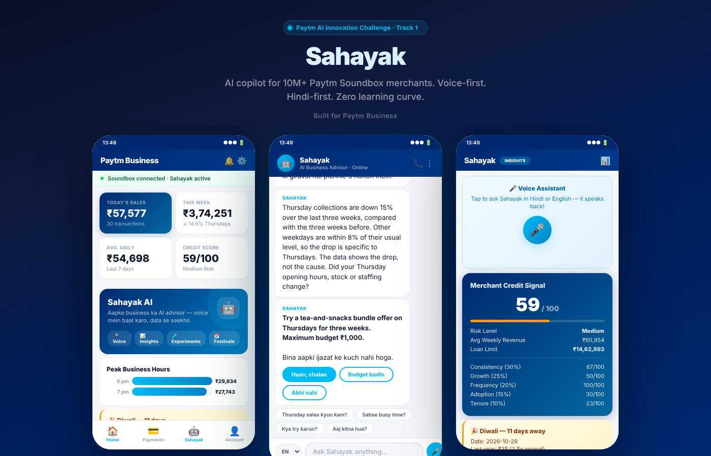
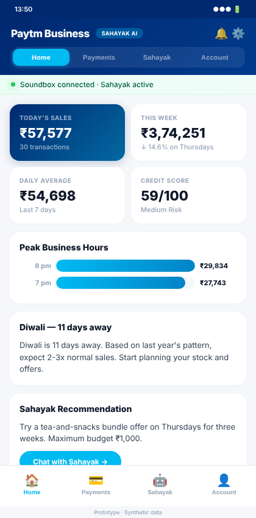
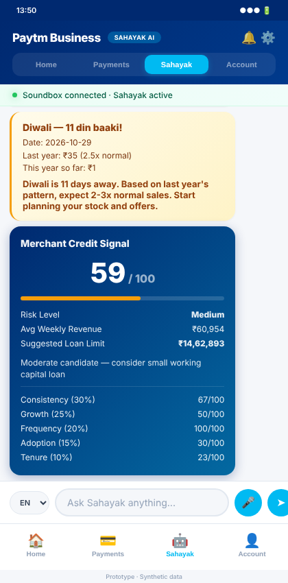
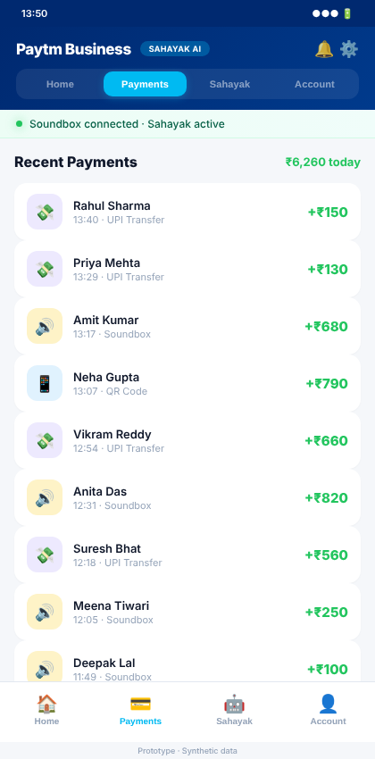
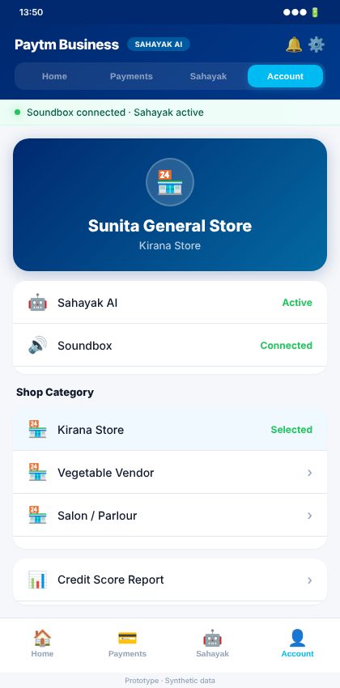

# Sahayak — AI Copilot for Paytm Soundbox Merchants

> **Paytm AI Innovation Challenge 2026 · Track 1: Merchant Growth AI · Finale Entry**

Sahayak is an AI-powered business advisor that lives inside the Paytm Business app. It turns raw Soundbox transaction data into actionable, voice-first insights for India's 10M+ small merchants — in Hindi, English, or Hinglish.

**No dashboards. No jargon. Just a soundbox that talks back.**

---

## Product Showcase



*Three screens side-by-side: Business Dashboard · AI Chat with Voice · Insights & Credit Score*

---

## App Screenshots

<table>
<tr>
<td width="25%" align="center"><br><b>Home Dashboard</b><br>Live sales stats, peak hours, credit score, festival alerts</td>
<td width="25%" align="center"><br><b>Sahayak AI Chat</b><br>Voice & text in Hinglish, festival cards, credit signal</td>
<td width="25%" align="center"><br><b>Payments</b><br>Real-time Soundbox transactions — QR, UPI, all in one view</td>
<td width="25%" align="center"><br><b>Account & Settings</b><br>Shop category, Sahayak controls, voice language</td>
</tr>
</table>

---

## Problem

80% of Paytm's Soundbox merchants are small shop owners — a paan wala, a kirana store, a chai stall. They have:

- **Zero analytics skills** — can't read charts or dashboards
- **No time** — running the shop alone, 12+ hours a day
- **Valuable data sitting unused** — every Soundbox beep is a transaction Paytm already has

The data exists. The merchant just needs someone to **explain it in their language and tell them what to do**.

---

## Solution

Sahayak is that someone. An AI layer on top of Paytm Soundbox:

| Step | What happens | Owner involvement |
|------|-------------|-------------------|
| **1. Notice** | Detects Thursday sales dropped 15% over 3 weeks | None — automatic |
| **2. Explain** | "Thursday collections are down compared to other days" | Listens via soundbox |
| **3. Suggest** | "Try a tea-and-snacks bundle, max ₹1,000 budget" | Hears the suggestion |
| **4. Decide** | Owner says "haan" (approve) or "nahi" (skip) | **Voice approval required** |
| **5. Measure** | After 3 weeks: "Thursday sales up 12% — the test worked" | Hears the result |

**Nothing happens without the owner's voice approval. Budget is always capped.**

---

## Architecture

```
Merchant speaks (Hindi/English)
        │
        ▼
  Sarvam AI STT (saaras:v4)
        │
        ▼
  FastAPI Server ──► SQLite (transaction data)
        │                    │
        │              trend.py ──► Weekday trend detection
        │           explainer.py ──► Plain-language insight  
        │            planner.py ──► Experiment engine + measurement
        │          festivals.py ──► 15 Indian festivals + YoY comparison
        │       credit_score.py ──► 5-component credit signal
        │     merchant_types.py ──► 6 shop categories
        │
        ▼
  Groq API (Llama 3.1 70B) ──► Contextual Hinglish answer
        │
        ▼
  Sarvam AI TTS (bulbul:v4-flash)
        │
        ▼
  Merchant hears the answer
```

---

## Features

| Feature | Description | Module |
|---------|-------------|--------|
| **Trend Detection** | Weekday-level sales comparison, flags drops >10% | `trend.py` |
| **Plain-Language Explainer** | Converts stats into simple Hinglish insights | `explainer.py` |
| **Smart Experiments** | Budget-capped A/B tests with auto-measurement | `planner.py` |
| **Voice Input/Output** | Hindi + English STT/TTS via Sarvam AI | `sarvam.py` |
| **LLM Chat** | Contextual Q&A powered by Groq (Llama 3.1 70B) | `groq_chat.py`, `answers.py` |
| **Festival Intelligence** | 15 Indian festivals, YoY comparison, stock alerts | `festivals.py` |
| **Merchant Credit Score** | 5-component weighted scoring (0-100) for lending | `credit_score.py` |
| **Category-Aware Advice** | 6 shop types with day-specific suggestions | `merchant_types.py` |
| **3-Screen Showcase** | Product-grade multi-phone demo for presentations | `showcase.html` |
| **Interactive Prototype** | Full single-phone demo with all 4 tabs | `demo_page.html` |

---

## Multi-Merchant Intelligence

Every merchant category gets **tailored suggestions** from the same engine:

| Category | Sahayak detects | AI suggests |
|----------|----------------|-------------|
| **Kirana store** | Thursday sales down 15% | "Tea-and-snacks bundle on Thursdays" |
| **Vegetable vendor** | Evening sales dropping | "Offer home delivery after 6 pm" |
| **Salon / parlour** | Weekday appointments low | "Thursday haircut discount ₹50 off" |
| **Chai stall** | Morning rush declining | "Add paratha combo for ₹30 before 10 am" |
| **Medical store** | Sunday sales zero | "Partner with clinic for Sunday OPD referrals" |
| **Stationery shop** | Post-exam season drop | "Push arts & crafts supplies on social media" |

---

## Credit Scoring for Paytm Lending

Sahayak generates a **merchant credit signal** from transaction patterns:

| Component | Weight | What it measures |
|-----------|--------|-----------------|
| Consistency | 30% | How regular are daily collections |
| Growth | 25% | Revenue trend over time |
| Frequency | 20% | How many transactions per day |
| Digital Adoption | 15% | QR + UPI usage vs cash |
| Tenure | 10% | How long on the platform |

**Result:** Auto-qualification for Paytm Merchant Loan — no paperwork, no branch visit.

---

## Festival Intelligence

Tracks **15 Indian festivals** and auto-triggers alerts:

- Before Diwali: *"Last Diwali week you did 3x normal sales. Stock up 2 days early."*
- Before Holi: *"Holi week colors and sweets drove 40% of revenue. Order extra."*
- After festival: *"Post-Diwali dip is normal — competitors dropped 20% too."*

---

## Tech Stack

| Layer | Technology | Why |
|-------|-----------|-----|
| **Backend** | Python 3, FastAPI | Lightweight, async, auto-docs |
| **Database** | SQLite | Zero-config, single-file, edge-ready |
| **LLM** | Groq (Llama 3.1 70B) | Free, fast inference |
| **Voice** | Sarvam AI (STT: saaras:v4, TTS: bulbul:v4-flash) | Built for Indian languages |
| **Frontend** | Vanilla HTML/CSS/JS | No build step, mobile-first |
| **Voice Fallback** | Browser Web Speech API | Works when Sarvam key unavailable |

---

## Quick Start

```bash
# 1. Clone
git clone https://github.com/devanshudhoble/Sahayak-.git
cd Sahayak-

# 2. Install dependencies
pip install fastapi uvicorn httpx groq python-dotenv

# 3. Add API keys
echo "GROQ_API_KEY=your_key_here" > .env
echo "SARVAM_API_KEY=your_key_here" >> .env

# 4. Run
python -m uvicorn server:app --reload

# OR on Windows:
start.bat
```

### URLs

| URL | What |
|-----|------|
| `http://localhost:8000/demo` | Single-phone interactive prototype |
| `http://localhost:8000/showcase` | 3-screen product showcase (for presentations) |
| `http://localhost:8000/docs` | Auto-generated API docs |

---

## API Endpoints

| Endpoint | Method | Description |
|----------|--------|-------------|
| `/demo` | GET | Interactive single-phone demo |
| `/showcase` | GET | 3-screen product showcase |
| `/api/status` | GET | Current trend, suggestion & decision state |
| `/api/decision` | POST | Owner approves/changes/skips suggestion |
| `/api/ask-text` | POST | Text question → Hinglish answer |
| `/api/ask-voice` | POST | Audio → transcript + answer + spoken reply |
| `/api/categories` | GET | List all 6 merchant categories |
| `/api/category` | POST | Change shop type (suggestions update) |
| `/api/festival` | GET | Upcoming festival + YoY comparison |
| `/api/credit-score` | GET | 5-component credit signal |

---

## Project Structure

```
sahayak/
├── server.py            # FastAPI server — all endpoints
├── demo_page.html       # Single-phone interactive prototype
├── showcase.html         # 3-screen product showcase
├── trend.py             # Weekday trend detection
├── explainer.py         # Plain-language insight generator
├── planner.py           # Experiment engine with budget caps
├── answers.py           # LLM-powered contextual Q&A
├── groq_chat.py         # Groq API integration
├── sarvam.py            # Sarvam AI voice (STT + TTS)
├── festivals.py         # 15 Indian festivals + YoY
├── credit_score.py      # 5-component merchant credit signal
├── merchant_types.py    # 6 shop categories with suggestions
├── data_gen.py          # Synthetic transaction data generator
├── screenshots/         # UI screenshots
├── .env                 # API keys (not committed)
└── start.bat            # Windows one-click launcher
```

---

## Why This Matters for Paytm

| Metric | Impact |
|--------|--------|
| **Merchant Retention** | Merchants who grow stay on the platform |
| **Transaction Revenue** | More transactions = more MDR |
| **Lending Business** | Credit scores unlock merchant lending |
| **Zero CAC** | Soundbox already deployed — Sahayak is software |
| **Moat** | Transaction data + AI = advice no competitor can replicate |

---

## Vision — From Speaker to Conversation

Today, Paytm Soundbox is a speaker. It only talks **TO** the merchant — "Payment received: two hundred rupees." The merchant never talks back.

**We're turning it into a conversation.**

The same hardware that says "payment received" can also say "your Thursday sales dropped 15% — want to try a bundle offer?" And the same microphone can hear "haan, chalao" and start a test.

**Only Paytm has both the transaction data AND the voice device already sitting on 10 million counters.** Sahayak turns that moat into a growth engine.

---

**Built for the Paytm AI Innovation Challenge 2026 Finale**

*Prototype uses synthetic transaction data. No real merchant data was used.*
